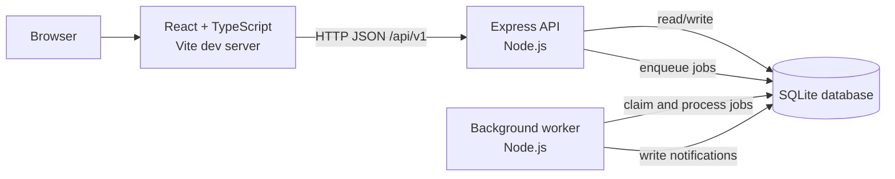

# Architecture

## System overview

Project Manager is a **modular monolith** with a separately run background
worker. The browser frontend, HTTP API, worker, and SQLite database have
separate responsibilities, but the API and worker share the same database
file. This keeps local setup simple while separating interactive requests from
asynchronous work.

During local development, Vite serves the frontend and proxies `/api` requests
to the backend. For deployment, configure an appropriate API URL and hosting
or reverse proxy; the Vite development proxy is not a production server.

## Technology and key choices

| Area | Technology | Responsibility |
| --- | --- | --- |
| Frontend | React, TypeScript, React Router | User interface, typed client code, and browser navigation. |
| Server state | TanStack Query | API data fetching, caching, loading/error states, and mutation updates. |
| Styling | Tailwind CSS | Responsive styling. |
| API | Node.js, Express, JSON over REST-style HTTP | Resource-oriented endpoints used by the frontend and other HTTP clients. |
| Validation | Zod | Validates bodies, path parameters, and query parameters at the API boundary. |
| Authentication | Signed JWT Bearer tokens | Authenticates API requests without a server-side session store. |
| Persistence | SQLite via `better-sqlite3` | Stores application data and the durable job queue in one database. |
| Background work | SQLite-backed job queue and Node.js worker | Processes notifications and scheduled due-date scans outside request handling. |
| Tests | Vitest and Testing Library | Exercises backend behavior and frontend user interactions. |

REST-style HTTP and JSON fit the app because it reads and changes conventional
resources such as projects, stories, tasks, members, and notifications. Standard
methods and JSON make the API straightforward to call from the browser, test
independently, and use with common HTTP tools. This is not a GraphQL or gRPC
API. See the [API guide](./api.md) for endpoints and payloads.

## Frontend

The React entry point is `frontend/src/main.tsx`. It mounts the app with shared
providers:

- `QueryClientProvider` provides the TanStack Query cache.
- `BrowserRouter` provides client-side navigation.
- `AuthProvider` loads and manages the authenticated user session.

`frontend/src/App.tsx` defines login, registration, projects, project detail,
and not-found routes. Protected routes wait for session validation and redirect
anonymous users to login.

The shared API client in `frontend/src/api/client.ts` attaches Bearer tokens,
sends and parses JSON, and turns server errors into typed API errors. The token
is kept in memory and persisted to local storage when available. Local storage
is readable by JavaScript, so an XSS vulnerability could expose a token;
httpOnly cookies reduce that risk but require CSRF defenses.

Hooks under `frontend/src/projects` encapsulate project and notification
queries and mutations. The notification bell polls the unread count and loads
the notification list when opened.

## Backend API

`backend/src/server.js` opens the database, applies migrations, and starts the
Express app. `backend/src/app.js` configures Helmet, CORS, JSON parsing, health
checks, route mounting, and centralized error handling.

Backend responsibilities are separated by directory:

- `routes/` connects HTTP paths to middleware and controllers.
- `schemas/` defines and validates accepted request shapes.
- `middleware/` enforces authentication, authorization, validation, and shared
  error responses.
- `controllers/` translates HTTP requests to service calls and service results
  to HTTP responses.
- `services/` implements business operations, transactions, activity logging,
  and job enqueueing.
- `repositories/` encapsulates database queries and writes.
- `config/` and `utils/` provide validated configuration and shared helpers.

Data is validated before service logic uses it. The error middleware maps
validation and application errors to the shared JSON error envelope. List
responses use `data`, `total`, `limit`, and `offset`.

## Authentication and authorization

Registration and login verify passwords with bcrypt and issue a signed JWT.
Protected endpoints expect `Authorization: Bearer <token>`. Authentication
middleware verifies the token and loads the current user; project-level
authorization then checks membership and role.

The project roles are:

- **Owner:** project and membership administration, plus all project work
  operations.
- **Member:** reads project content and creates/updates stories and tasks; may
  delete tasks.
- **Viewer:** reads project content, without write access.

The API also applies request validation, login and registration rate limits,
Helmet security headers, and configured CORS. `JWT_SECRET` is backend-only and
must not be exposed to the frontend.

## Data and persistence

SQL migrations live in `backend/src/db/migrations`. The migration runner
records applied filenames in `schema_migrations`; both API and worker apply
migrations on startup. SQLite connections enable foreign keys, WAL journaling,
and a busy timeout.

Core entities include:

- `users` and `project_members`: accounts, memberships, and project roles.
- `projects`: project metadata and archive state.
- `user_stories` and `tasks`: work hierarchy, statuses, assignments, and
  ordering. A task `due_date` is a calendar date (`YYYY-MM-DD`), not a
  timestamp.
- `activity_log`: project activity.
- `notifications`: user-targeted notifications and read state.
- `jobs`: durable background work, attempts, locks, and results.

Foreign keys and indexes are defined by migrations. The default database file
is `backend/data/app.db`; `DB_PATH` can override it. The database and SQLite
WAL files are local runtime data and should not be committed. The API and
worker must use the same `DB_PATH`.

## Background jobs and notifications

The API writes asynchronous work to the `jobs` table. The worker polls for due
jobs, claims them, calls a registered handler, and stores success or failure.
Failed jobs retry with backoff up to the configured attempt limit; stuck locks
can be recovered. Idempotency keys prevent retries or repeated scans from
creating duplicate notification records.

The worker handles two job types:

1. **`send_notification`** inserts an in-app notification through the shared
   notification repository. Completion notifications go to the project owner
   when someone other than the owner completes a task or story. Due reminders
   go to the task assignee. Email delivery is simulated; there is no external
   email provider configured.
2. **`due_reminder_scan`** is enqueued at worker startup and then every
   `REMINDER_SCAN_MS` (15 minutes by default). It finds assigned, non-done
   tasks whose dates are due soon or overdue and enqueues notification jobs.
   Reminder idempotency keys are scoped by task, type, and UTC calendar date.

The notification API only returns the authenticated user's own notifications.
The frontend polls unread counts and supports marking individual or all
notifications as read.

## Runtime processes

Local development uses three separate terminals:

1. `npm run dev` from `backend` starts the Express API.
2. `npm run worker` from `backend` starts queue processing and the reminder
   scheduler.
3. `npm run dev` from `frontend` starts Vite.

The API also provides `/health` for a basic server/database check.

## Testing boundaries

Backend Vitest tests cover services, repositories, routes, and jobs, using test
databases including in-memory SQLite where appropriate. Frontend Vitest tests
use jsdom and Testing Library; API requests are mocked so tests do not require
a running backend. The frontend production build runs the TypeScript build
before bundling with Vite.