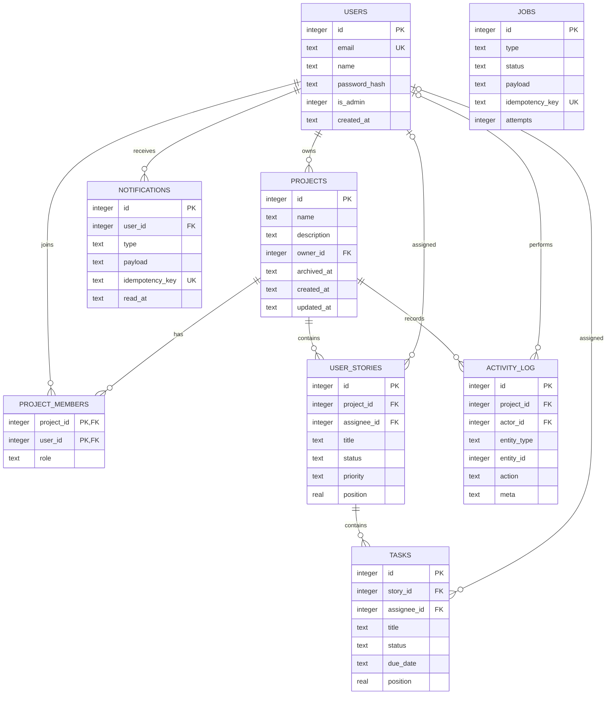

# Database schema

## Overview

Project Manager uses SQLite through `better-sqlite3`. The schema is defined by
ordered SQL migrations in `backend/src/db/migrations/`; the current initial
schema is [`001_init.sql`](../backend/src/db/migrations/001_init.sql). The
migration runner records applied filenames in `schema_migrations`, and the API
and worker apply pending migrations at startup.

The default database path is `backend/data/app.db`, configurable with the
backend `DB_PATH` environment variable. The database is local runtime data;
keep it, along with SQLite WAL files, out of source control. Back it up before
making changes to a database that contains data you need.

SQLite connections enable foreign-key enforcement, write-ahead logging (WAL),
a five-second busy timeout, and `synchronous = NORMAL`.

## Entity relationships

## Tables

### `users`

Stores accounts and authentication metadata.

| Column | Meaning |
| --- | --- |
| `id` | Auto-incrementing primary key. |
| `email` | Required and unique without regard to letter case (`COLLATE NOCASE`). |
| `name` | Required display name. |
| `password_hash` | Required bcrypt password hash; plaintext passwords are not stored. |
| `is_admin` | Integer boolean, restricted to `0` or `1`, default `0`. |
| `created_at` | UTC timestamp set by SQLite on insert. |

### `projects`

Stores project details and archive state. `owner_id` references `users.id`.
`archived_at` is `NULL` for active projects and a UTC timestamp for archived
ones. Project ownership is also represented in `project_members` with role
`owner`.

### `project_members`

Connects users to projects and defines their access role. The composite primary
key `(project_id, user_id)` prevents duplicate membership. `role` is constrained
to `owner`, `member`, or `viewer`. A partial unique index permits at most one
owner membership per project. Deleting a project or user cascades to their
membership rows.

### `user_stories`

Stores stories within projects, including title, description, acceptance
criteria, status, priority, optional story points, optional assignee, and
ordering position. Status is constrained to `backlog`, `in_progress`,
`in_review`, or `done`; priority is `low`, `medium`, or `high`. Deleting a
project cascades to its stories. Deleting an assignee sets `assignee_id` to
`NULL`.

### `tasks`

Stores tasks within stories, with title, description, status, optional
assignee, optional estimate, optional due date, and ordering position. Status
is constrained to `todo`, `in_progress`, or `done`. `due_date` is stored as
text in `YYYY-MM-DD` calendar-date format, not as an instant or time of day.
Deleting a story cascades to its tasks; deleting an assignee sets
`assignee_id` to `NULL`.

### `activity_log`

Stores project activity with project ID, optional actor, entity type and ID,
action, JSON-encoded metadata text, and creation timestamp. Deleting a project
cascades to its activity; deleting the actor sets `actor_id` to `NULL`.

### `notifications`

Stores notifications for a recipient user. `payload` is JSON-encoded text;
`type` identifies the event; `read_at` is `NULL` until read. The required
unique `idempotency_key` prevents a repeated job from inserting the same
notification twice. Deleting a user cascades to that user's notifications.

### `jobs`

Stores the durable background work queue. Job payload/result fields are
JSON-encoded text. `status` is constrained to `pending`, `running`, `succeeded`,
or `dead`. Attempts and maximum attempts have non-negative/positive
constraints. `run_at`, lock fields, error text, result, idempotency key,
creation time, and finish time support scheduling, retry, recovery, and
inspection. Job idempotency keys are unique when present.

### `schema_migrations`

Created by the migration runner rather than the initial SQL migration.
`filename` is the primary key and records each successfully applied migration;
`applied_at` records when it ran.

## Indexes and constraints

The initial migration defines these indexes:

| Index | Purpose |
| --- | --- |
| `idx_projects_owner_id` | Find projects by owner. |
| `idx_project_members_one_owner` | Enforce at most one owner membership per project. |
| `idx_project_members_user_id` | Find projects associated with a user. |
| `idx_user_stories_project_status` | Filter stories by project and status. |
| `idx_user_stories_assignee_id` | Find stories by assignee. |
| `idx_tasks_story_status` | Filter tasks by story and status. |
| `idx_tasks_assignee_id` | Find tasks by assignee. |
| `idx_tasks_due_date` | Find tasks by due date for reminder scans. |
| `idx_activity_log_project_id` | Read activity by project. |
| `idx_activity_log_actor_id` | Find activity by actor. |
| `idx_notifications_user_read` | List and count a user's unread notifications. |
| `idx_jobs_status_run_at` | Find pending jobs ready to run. |

Other important constraints include unique user emails, unique project/user
membership pairs, unique notification/job idempotency keys, foreign keys,
role/status enumerations, and non-negative values for story points and task
estimates.

## Migration practice

1. Add a new, sequentially named SQL migration; do not edit an already-applied
   migration for a deployed database.
2. Keep schema changes and application code compatible with the migration
   order.
3. Test migrations against both a fresh database and an existing database with
   prior migrations applied.
4. Back up important SQLite files before applying schema changes to retained
   local data.

The migration runner executes each migration and records its filename in a
transaction. Both `npm run dev` and `npm run worker` apply pending migrations
on startup.